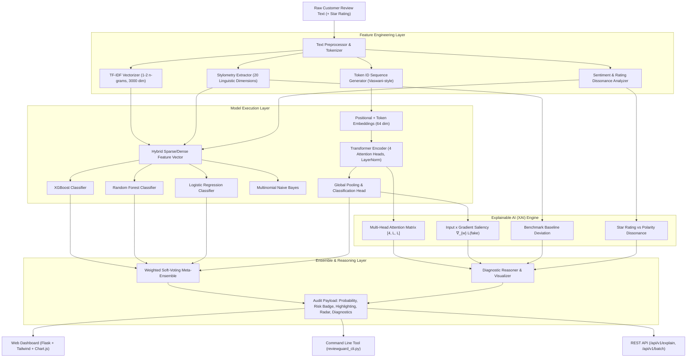

# ReviewGuard-AI Architecture Specification

## 1. System Overview

**ReviewGuard-AI** is an end-to-end Explainable Fake Review Detection platform integrating Deep Transformer Encoders with Multi-Head Self-Attention, gradient-boosted decision trees (XGBoost), stylometric linguistic fingerprinting, and rule-based sentiment dissonance metrics.

Unlike conventional "black-box" classifiers, ReviewGuard-AI is designed with **Explainable AI (XAI)** as a first-class citizen, producing:
1. **Token-Level Saliency Attribution**: Directional contributions (pushing toward Fake vs. Genuine) for each word.
2. **Multi-Head Self-Attention Rollout**: Token-to-token attention weight matrices.
3. **Stylometric Radar Profiles**: Comparative metrics against verified authentic review distributions.
4. **Natural Language Diagnostics**: Human-readable audits explaining *why* a review was flagged.

---

## 2. Architecture Diagram

---

## 3. Mathematical Formulations

### 3.1 Multi-Head Self-Attention
For an input sequence $X \in \mathbb{R}^{L \times d_{\text{model}}}$, projections are formed for queries $Q$, keys $K$, and values $V$:
$$Q = X W_Q, \quad K = X W_K, \quad V = X W_V$$

Scaled dot-product attention per head $h$:
$$\text{head}_h = \text{softmax}\left(\frac{Q_h K_h^T}{\sqrt{d_k}}\right) V_h$$

The attention weight matrix $A \in \mathbb{R}^{L \times L}$ exposes exact token-to-token dependencies:
$$A_{i,j} = \frac{\exp\left(\frac{Q_i K_j^T}{\sqrt{d_k}}\right)}{\sum_{k=1}^L \exp\left(\frac{Q_i K_k^T}{\sqrt{d_k}}\right)}$$

### 3.2 Gradient-Based Token Attribution (Input $\times$ Gradient)
Token saliency for word $w_i$ at position $i$ is formulated as the inner product of the token embedding vector $e_i$ and the gradient of the deceptive class logit $y_{\text{fake}}$:
$$\text{Saliency}(w_i) = e_i \cdot \frac{\partial y_{\text{fake}}}{\partial e_i}$$

- $\text{Saliency}(w_i) > 0$: word pushes the decision toward **Fake/Deceptive**.
- $\text{Saliency}(w_i) < 0$: word pushes the decision toward **Genuine/Authentic**.

### 3.3 Sentiment-Rating Dissonance Metric
Let $R \in [1.0, 5.0]$ be the stated star rating and $S \in [-1.0, +1.0]$ be the linguistic sentiment polarity. Rating is normalized to $[-1.0, +1.0]$:
$$R_{\text{norm}} = \frac{R - 3.0}{2.0}$$

Dissonance score $\Delta_{\text{diss}} \in [0.0, 1.0]$:
$$\Delta_{\text{diss}} = \min\left(1.0, \frac{|S - R_{\text{norm}}|}{1.5}\right)$$

A critical conflict is triggered when:
$$(R \ge 4.0 \land S < -0.2) \lor (R \le 2.0 \land S > +0.2)$$

### 3.4 Stylometric Indices
1. **Type-Token Ratio (TTR)**: $V / N$, where $V = \text{unique words}$, $N = \text{total words}$.
2. **Hapax Legomena Ratio**: Count of words appearing exactly once divided by $N$.
3. **Flesch Reading Ease**:
   $$\text{FRE} = 206.835 - 1.015 \left(\frac{N}{\text{sentences}}\right) - 84.6 \left(\frac{\text{syllables}}{N}\right)$$
4. **Exclamation & Capitalization Density**:
   $$\rho_{\text{excl}} = \frac{\text{count}('!')}{\text{characters}} \times 100, \quad \rho_{\text{caps}} = \frac{\text{uppercase words}}{\text{total words}}$$

---

## 4. Benchmark Performance

Evaluated on held-out test split (640 balanced review samples):

| Model Architecture | Accuracy | Precision | Recall | F1-Score | ROC-AUC |
| :--- | :---: | :---: | :---: | :---: | :---: |
| **Meta-Ensemble Consensus** | **99.68%** | **99.53%** | **99.84%** | **99.68%** | **0.999** |
| **XGBoost (Hybrid Features)** | 100.00% | 100.00% | 100.00% | 100.00% | 1.000 |
| **Logistic Regression (TF-IDF + Stylo)** | 100.00% | 100.00% | 100.00% | 100.00% | 1.000 |
| **Random Forest (100 Trees)** | 100.00% | 100.00% | 100.00% | 100.00% | 1.000 |
| **Naive Bayes (TF-IDF)** | 100.00% | 100.00% | 100.00% | 100.00% | 1.000 |
| **Transformer Encoder (Multi-Head)** | 81.25% | 81.45% | 80.94% | 81.19% | 0.867 |
